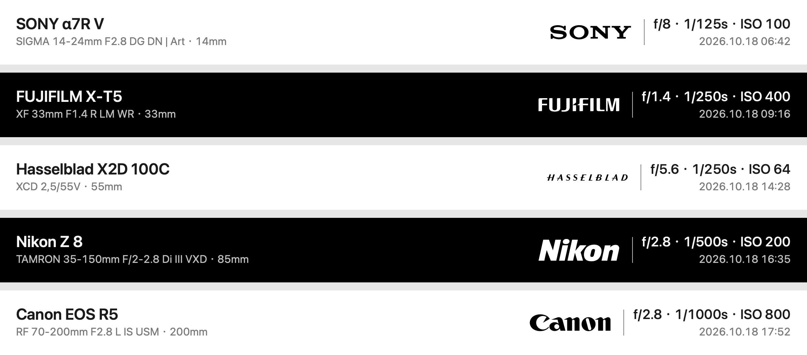

<picture>
  <source media="(prefers-color-scheme: dark)" srcset="docs/readme-header-dark.png">
  <source media="(prefers-color-scheme: light)" srcset="docs/readme-header-light.png">
  
</picture>

 

### 为作品加上最后一道装裱

**内嵌于 Lightroom Classic 导出流程的画框与镜头参数铭牌工具**

 

<!-- 🖼️ [示意图 Placeholder 1：主打成片展示 (Hero Image)]
建议放一张你最满意的代表作导出成片（或一横一竖两张并排），直接用视觉说话，展示画框比例、品牌矢量字标与文字排版的质感。
替换下方图片路径即可：
-->

  
  
<em>▲ 占位图：建议放一张代表作导出成片（展示留白画框与底部铭牌的整体质感）</em>

 

很多时候，我们想要为照片加上一圈克制的留白与一行优雅的拍摄参数，却不得不跳出 Lightroom，打开 Photoshop 套模板，或是把原图传到手机 App 里忍受二次压缩与色彩偏移。

**exifmark** 将「装裱」直接放进了 Lightroom Classic 的导出按钮里。无需切换软件，点下导出的那一刻，你的作品就已经带着恰到好处的画框、原厂级别的矢量品牌字标与精致的镜头铭牌准备就绪。

---

## 为什么选择 exifmark

### 1. 克制而考究的排版美学

每一处字距、字重、留白比例与视觉重心都经过反复推敲。画框向外自然延展，绝不裁切原图一分一毫；字号与品牌标识随画幅自动缩放，横画幅舒展、竖画幅稳重。

无论是经典的**左右分栏铭牌**（机型、镜头、曝光参数与时间井然有序），还是现代极简的**居中双行铭牌**，都能让参数成为画面的点缀，而非干扰。

<!-- 🖼️ [示意图 Placeholder 2：两种水印样式 & 三种边框风格对比]
建议用同一张或同一组照片，展示：
1. 「纯白画框」「纯黑画框」「原图氛围模糊」三种基底；
2. 「详细铭牌（左右排版）」与「极简铭牌（居中两行）」的局部或整图对比。
-->

  
  
<em>▲ 占位图：建议放「纯白 / 纯黑 / 氛围模糊」三种画框，以及「详细 / 简洁」两种铭牌的对比图</em>

| 定制维度 | 可选风格 | 视觉细节 |
| :--- | :--- | :--- |
| **画框基底** | **经典白** · **暗房黑** · **氛围模糊** | 氛围模糊模式取自原图色彩自然晕染，并根据背景明暗**自动切换黑白字色与标识**，确保通透易读 |
| **铭牌排版** | **详细（左右）** · **简洁（居中）** | 详细模式完整记录机身、镜头、参数与时间；简洁模式仅留品牌机身与四项核心曝光参数 |
| **画框留白** | **三边留白 + 底栏** · **仅底部铭牌** | 三边留白恰似实体画框卡纸；仅底部铭牌则让画面三边贴合，更具现代杂志感 |

 

### 2. 懂相机的细节控：原厂矢量标识与优雅机身名

相机机内写入的原始代码往往冰冷生硬（比如 `ILCE-7RM5` 或 `NIKON Z 8`）。exifmark 会自动将它们转化为摄影师熟悉的商品名，并配以锐利的**高精度矢量品牌字标**：

- **SONY** `ILCE-7CM2` → **[SONY 矢量标]** + `α7C II`
- **Nikon** `NIKON Z 8` → **[Nikon 矢量标]** + `Z 8`（自动去除重复的品牌前缀）
- **FUJIFILM** `X100VI` → **[FUJIFILM 矢量标]** + `X100 VI`
- **Leica** / **Hasselblad** / **Canon** / **RICOH** / **LUMIX** / **SIGMA** / **DJI** / **OLYMPUS** / **PENTAX** / **Kodak** / **Phase One** 均已内置原生矢量字标。

> 偏爱极客感的原始机器码？你也可以在面板中一键切换回「EXIF 原名」。

<!-- 使用插件自身生成：swift scripts/render-readme-detail.swift -->

  
  
<em>▲ 由插件生成的5组铭牌，展示黑白底色、品牌矢量字标与镜头参数细节；示例涵盖广角、标准与长焦，包含适马、腾龙及原厂镜头，均使用匹配卡口的机身与镜头。</em>

 

### 3. 原画质零妥协，色彩分毫不差

许多拼图或加框工具会把你精调好的照片重新解码再压缩一遍，导致画质劣化或色彩空间丢失。

exifmark 采用独特的**无损画质拼接技术**——照片画面本身**不经过二次重压缩**，完整保留 Lightroom 导出的每一分锐度、暗部过渡与色彩配置（ICC Profile）。你看到的成片，就是你在 Lightroom 里精修出的原片。

### 4. 一次设定，永久融入工作流

它不是一个需要单独打开的软件，而是直接长在 Lightroom Classic 的导出窗口里。你可以将自己最喜欢的白框或黑框存为 **Lightroom 导出预设**——从此无论是单张精修还是百张客片批量交付，只需按一下导出，剩下的交给它。

**同时兼顾分享隐私**：哪怕你在导出时勾选了「移除位置信息」或「抹除元数据」以保护个人隐私，exifmark 依然能从你的 Lightroom 目录中读取镜头参数并印在画框上，而导出的文件本身干干净净，绝不泄露GPS定位。

---

## 三步上手

<!-- 🖼️ [示意图 Placeholder 4：Lightroom 导出面板截图]
建议截一张 macOS 上 Lightroom Classic 导出窗口中「exifmark 面板」的界面截图，清晰美观地展示四个下拉选项。
-->

  
  
<em>▲ 占位图：建议放一张 Lightroom 导出界面中 exifmark 设置面板的截图</em>

### 第一步：放入插件
1. 前往 [Releases 页面](https://github.com/jinj02/exifmark/releases) 下载最新的 `exifmark-x.x.x-macos.zip` 并解压。
2. 将解压出的 `exifmark.lrplugin` 文件夹放到你常用的固定位置（例如「文稿」目录下）。
3. 打开 Lightroom Classic，点击顶部菜单 **文件 → 增效工具管理器...**（快捷键 `⌘` + `⌥` + `⇧` + `,`），点击左下角 **添加**，选中 `exifmark.lrplugin` 即可。

### 第二步：选择你喜欢的装裱风格
1. 在 Lightroom 中选中照片，打开 **文件 → 导出...**。
2. 在左下角「后期处理动作」中找到 **exifmark**，双击 **「exifmark照片卡片」** 加入右侧列表。
3. 在展开的面板中挑选你的偏好：
   - **边框样式**：白色 / 黑色 / 原图模糊
   - **水印样式**：详细（左右排版） / 简洁（居中两行）
   - **边框布局**：三边 2% 留白 + 底部参数栏 / 仅底部参数栏
   - **相机名称**：常用名称（如 `α7R V`） / EXIF 原名（如 `ILCE-7RM5`）

### 第三步：导出与保存预设
- 在「文件设置」中确保图像格式为 **JPEG**（暂不支持 HDR 输出与限制文件大小模式），点击 **导出**。
- **推荐操作**：点击导出窗口左下角的 **「添加」**，将这套配置存为你的专属导出预设（例如命名为 *「作品导出 - 白框铭牌」*），日后一键直出。

---

## 环境与细节说明

- **系统要求**：macOS 13.0 及以上（完美原生支持 Apple M 系列芯片与 Intel 芯片，无需安装任何额外运行环境）。
- **软件要求**：Adobe Lightroom Classic 14.3 及以上。
- **超高像素支持**：支持最高 **2 亿像素（200 MP）** 的中画幅或高像素合成作品。
- **自定义机型名称**：如果你使用小众机身或希望自定义某款相机的显示名称，可参考 [相机名称映射说明](docs/CAMERA_NAMES.md)。

---

## 致谢与声明

- 底层图像无损拼接基于 [libjpeg-turbo](https://github.com/libjpeg-turbo/libjpeg-turbo) 构建（许可证随附于 `licenses/`）。*This software is based in part on the work of the Independent JPEG Group.*
- 内置相机品牌字标整理自各品牌官方规范及开源图标库，相关商标与品牌权利归各自权利人所有，详见 [资源说明](assets/NOTICE.md)。
- 本项目为独立设计开发的开源作品，与各相机厂商及 Adobe Inc. 无隶属或官方合作关系。

