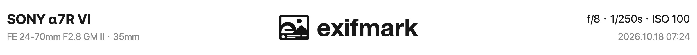

<picture>
  <source media="(prefers-color-scheme: dark)" srcset="docs/readme-header-dark.png">
  <source media="(prefers-color-scheme: light)" srcset="docs/readme-header-light.png">
  
</picture>

**为 Lightroom Classic 导出的照片自动生成 EXIF 参数边框卡片**

---

**exifmark** 是一款针对 macOS 平台的 Adobe Lightroom Classic (LrC) 导出增效工具。它直接嵌入 LrC 的导出流程中，无需借助 Photoshop 或第三方拼图软件，即可在导出 JPEG 照片时自动加上画框留白、相机与镜头型号、SONY 矢量字标、曝光参数（光圈 / 快门 / ISO）以及拍摄时间。

底层渲染采用macOS原生Swift、CoreGraphics、CoreText与ImageIO，静态链接libjpeg-turbo处理JPEG压缩系数，保留照片区域的原始量化系数与色彩空间配置。

## ✨ 功能特性

- **原生集成 LrC 导出管线**：作为「后期处理动作」挂载，支持直接随 LrC 导出预设（Preset）保存和批量导出。
- **独立边框与水印样式**：
  - **边框样式**：白色、黑色、原图模糊。模糊背景由原图等比铺满画布生成，照片主体保持清晰，整条水印根据其下方背景自动选择黑字或白字，品牌字标与分隔线同步切换。
  - **详细水印**：沿用左右排版，展示相机、镜头与焦距、曝光参数和拍摄时间。
  - **简洁水印**：居中两行，上行是品牌字标与相机型号（如Nikon字标＋Z 8），型号文字省略重复的品牌名；下行是焦距、光圈、快门和ISO，缺失参数自动跳过。
  - 三种边框样式与两种水印样式可自由组合，并支持以下两种边框布局：
  - **三边留白 + 底部参数栏（默认）**：上、左、右各追加照片宽度 `2%` 的留白边框，底部追加 `8%` 的参数栏。
  - **仅底部参数栏**：照片上、左、右三边贴边，仅底部追加照片宽度 `8%` 的参数栏。
- **保留照片压缩数据**：所有外框与参数栏均向外扩展画布，直接复制LrC导出JPEG的量化DCT系数，照片区域免于二次有损编码。边框位置和照片占位向上对齐JPEG的MCU块，末端不足整块的部分保留原有块并向外补齐。
- **相机品牌识别**：根据相机厂商自动选择SONY、Canon、Nikon、FUJIFILM、Leica、Panasonic、LUMIX、PENTAX、RICOH、Hasselblad、SIGMA、DJI、Kodak、OLYMPUS或Phase One字标，适配黑白主题；未知品牌留空。
- **相机型号命名**：默认显示常用商品名，索尼微单通过系列正则解析代际与后缀，其他品牌使用已核实映射；可切换EXIF原名。常用名称水印显示厂商与型号，自动避免重复厂商；EXIF模式直接显示原始型号，不额外添加厂商。未知型号自动回退原名，原始品牌、型号及文件元数据保持完整。[映射覆盖与维护说明](docs/CAMERA_NAMES.md)。
- **智能排版与防溢出**：字号、Logo 与边距随照片宽度同比缩放；过长的相机或镜头名称会自动缩字（最低至 `75%`）并在超宽时优雅省略；缺失的 EXIF 字段自动留空。
- **色彩与隐私安全**：
  - LrC按导出窗口中的质量输出JPEG。新增边框和参数栏使用这张JPEG的实际量化表、色度采样与分量配置进行压缩，再拼接原照片的量化系数并优化熵编码。整个流程无需TIFF中转或临时入库，继承原JPEG的ICC配置。
  - 展示的拍摄参数直接读取自 LrC 目录——即使你在导出设置中选择「移除位置信息」或「仅版权信息」，画面上的参数依然正常渲染，同时严格遵守导出隐私设置不向文件写入多余 EXIF。
- **开箱即用**：内置 `arm64` + `x86_64` 通用二进制程序（Universal Binary），用户无需安装 Swift、Python 或 ImageMagick。

---

## 🚀 安装与使用

### 环境要求

- **操作系统**：macOS 13.0 (Ventura) 及以上（支持 Apple Silicon 与 Intel）
- **宿主软件**：Adobe Lightroom Classic14.3及以上

### 1. 安装插件

1. 从[Releases](https://github.com/jinj02/exifmark/releases)下载`exifmark-<版本>-macos.zip`，解压后将完整的`exifmark.lrplugin`文件夹移动到固定目录（如`~/Documents/LightroomPlugins/`，请保留完整的`bin`目录）。开发包在[Actions](https://github.com/jinj02/exifmark/actions/workflows/ci.yml)的成功运行页面下载；首次正式版为`0.1.0`。
2. 打开 Lightroom Classic，在顶部菜单栏选择 **文件 → 增效工具管理器...**（快捷键 `⌘` + `⌥` + `⇧` + `,`）。
3. 点击左下角的 **添加**，选中刚才放置的 `exifmark.lrplugin` 文件夹并确认。

### 2. 导出照片

1. 在 LrC 中选中要导出的照片，打开 **文件 → 导出...**。
2. 在导出窗口左下角的 **后期处理动作 (Post-Processing)** 列表中找到 **exifmark**，双击 **「exifmark照片卡片」** 将其加入右侧导出处理链。
3. 在弹出的 **exifmark 面板** 中选择：
   - **边框样式**：白色／黑色／原图模糊
   - **水印样式**：详细（左右排版）／简洁（居中两行）
   - **边框布局**：三边 2% 留白 + 底部 8% 参数栏 / 仅底部 8% 参数栏
   - **相机名称**：常用名称（默认）／EXIF原名
4. 在 LrC 的 **文件设置 (File Settings)** 中确认：
   - 图像格式选择 **JPEG**
   - **取消勾选**「HDR 输出」
   - **取消勾选**「限制文件大小」
5. 点击 **导出** 即可。

> [!TIP]
> - **保存为导出预设**：你可以点击导出窗口左下角的「添加」将当前配置存为LrC导出预设，边框样式、水印样式、边框布局、相机命名方式会一并保存，下次一键导出。默认使用白色边框与详细水印，旧预设继续沿用原有效果。
> - **与其他插件联用**：如果同时挂载了其他后期处理动作，建议将 **exifmark** 放在处理链的最后一个。

---

## ⚠️ 已知限制与兼容性

- **仅支持 SDR JPEG 导出**：若在导出设置中选择了 TIFF / PNG / DNG 等其他格式、开启了「HDR 输出」或开启了「限制文件大小」，插件会在面板中给出提示并禁用导出按钮。
- **JPEG块对齐**：2%边框和8%参数栏按JPEG块向上取整，常见块尺寸为8×8或16×16像素。照片占位同步补齐到整块，尺寸可能增加少量像素；EXIF方向标记保留，照片无需旋转重编码。
- **画布尺寸上限**：单张最终成片最大支持 2 亿像素（200 MP），且单边宽高不超过 `65,535 px`。
- **批量处理与取消**：成片先写入目标目录内的临时文件，再原子替换目标文件；导出结束后清理临时JPEG和请求文件。单张失败按张报告，其他照片继续处理；取消会在当前照片处理完成后停止后续照片。

## 📄 声明与致谢

- JPEG处理静态链接[libjpeg-turbo](https://github.com/libjpeg-turbo/libjpeg-turbo)，许可证随插件放在`licenses/`。This software is based in part on the work of the Independent JPEG Group.
- 内置相机品牌字标来自厂商官网、Wikimedia Commons、Simple Icons及Camera-Logos-SVG，相关商标与名称权利归各自权利人所有。详见[资源说明](assets/NOTICE.md)。
- 本项目为独立开发的开源工具，与相机厂商及Adobe Inc.无隶属、赞助或官方合作关系。
